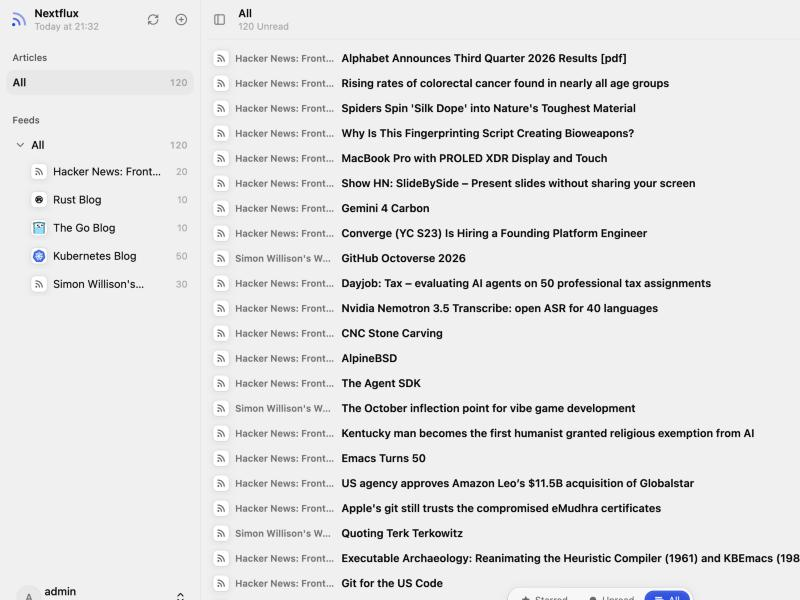
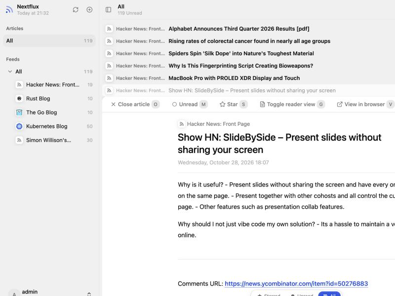
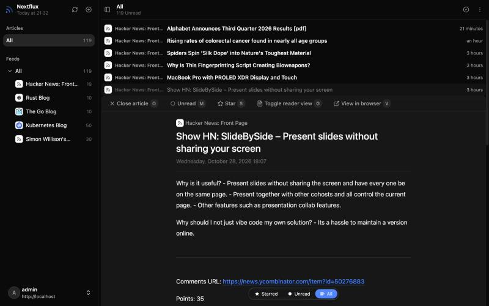
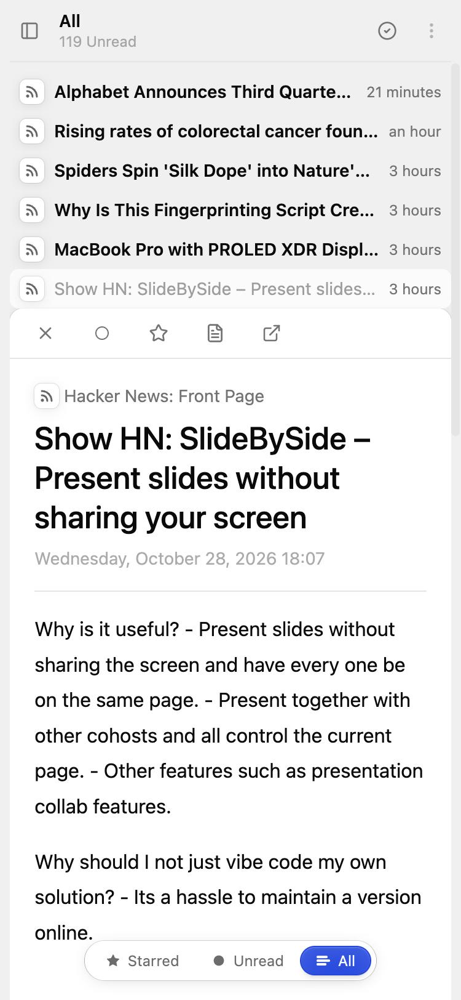
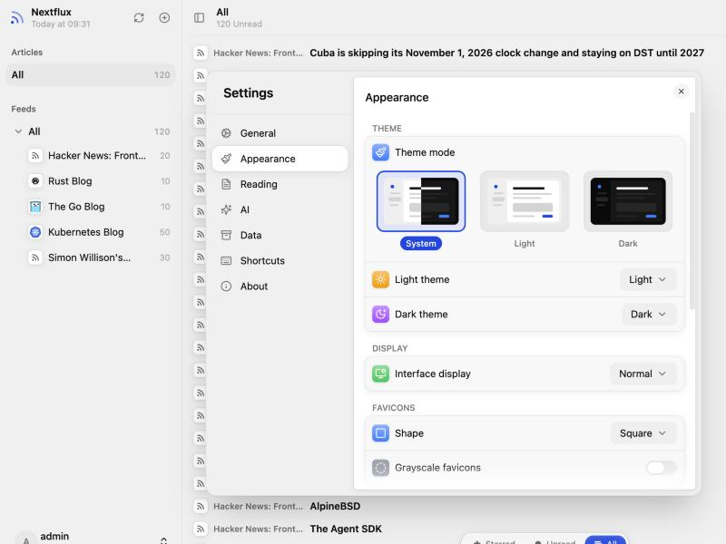
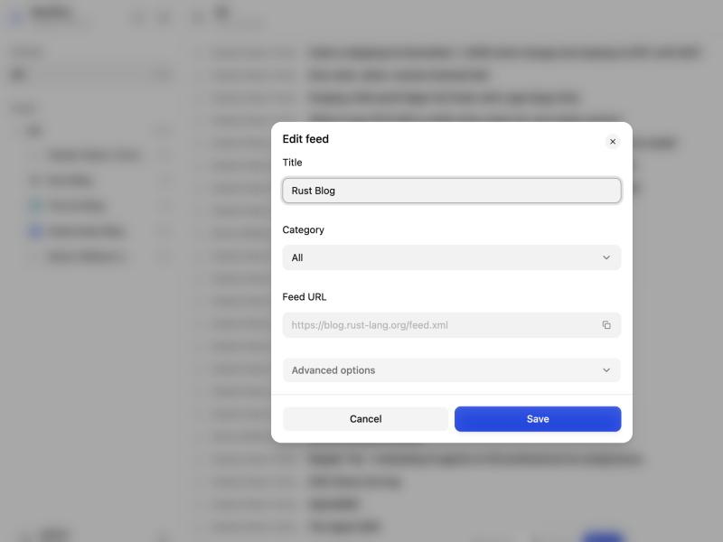

# Nextflux — Feedly-style fork

A fork of [electh/nextflux](https://github.com/electh/nextflux), the Miniflux
web client built with React + Vite. Everything upstream does still works; this
fork changes the reading flow to match Feedly's title-only view and adds its
shortcuts and preferences.

| Compact list | Article opened inline |
| --- | --- |
|  |  |

| Dark theme | Mobile |
| --- | --- |
|  |  |

| Settings | Edit feed |
| --- | --- |
|  |  |

## 🍃 What's different

- **Compact list, Feedly-style** (default; Settings → Appearance → List layout):
  one row per article (source, title, time), the article opens *inline* under
  its row instead of in a reader panel. Switch back to *Cards* for the upstream
  two-pane view. Row density is configurable (Compact / Cozy / Comfortable).
- **Mark as read on scroll** (on by default): rows that scroll past the top of
  the list are marked read, as in Feedly's title-only view. Under the *Unread*
  filter they stay on screen, dimmed, until you open another list or refresh
  (`R`), so the list does not jump while you read.
- **Mark-as-read menu** (header check icon) also offers *older than a day /
  week / month*.
- **Feedly preferences**: start page (All / Unread / Starred / first category),
  *Hide feeds without unread articles* (on by default); sort order, theme,
  fonts and text size were already upstream settings.
- **Preconfigured server**: the login page is prefilled from `public/config.js`
  (`window.NEXTFLUX_CONFIG = { serverUrl, authType, lockServerUrl }`), which a
  deployment can replace at runtime (e.g. a ConfigMap mounted over
  `/srv/config.js`), or from build-time `VITE_DEFAULT_SERVER_URL` /
  `VITE_DEFAULT_AUTH_TYPE` / `VITE_LOCK_SERVER_URL` (see `.env.example`).
  Credentials are still entered once per browser; nothing secret is baked in.
- Images are published to `ghcr.io/timvw/nextflux` (`latest`, `main`,
  `sha-<commit>`) by the Docker publish workflow.

### Keyboard shortcuts (Feedly layout)

| Key | Action |
| --- | --- |
| `J` / `K` | Open next / previous article inline |
| `N` / `P` | Select next / previous row without opening |
| `O` / `Enter` | Open the selected row, or close the open article |
| `Esc` | Close the open article |
| `M` / `S` / `V` | Toggle read / toggle star / open original in a new tab |
| `X` | Mark the current row as read and move to the next |
| `G` (alone) | Toggle reader view (fetched original content) |
| `Shift+A` | Mark the current list as read (asks first) |
| `R` | Refresh |
| `F` / `Ctrl+K` | Search |
| `G A` / `G T` / `G L` / `G P` | Go to All / Unread / Starred / Settings |
| `Shift+J` / `Shift+K` | Next / previous feed or category |
| `Shift+X` | Expand / collapse the current category |
| `[` / `Ctrl+B` | Toggle the sidebar |
| `Shift+N` | Add feed |
| `?` | Show this list in the app |

## ✨ Features

- 🚀 Fast and responsive UI built with HeroUI (Previously NextUI)
- 🌐 Connect to your Miniflux server
- 👥 Save multiple Miniflux accounts and switch between them with separate caches
- 🔄 Automatic background sync with configurable intervals
- 📱 Mobile-friendly with PWA support
- 🌙 Light/Dark mode with multiple theme options
- 🌍 i18n support (English & Chinese & Turkish & French)
- 👀 Mark as read on scroll
- 🎯 Rich reading experience
    - Custom font settings
    - Image gallery with touch gestures support
    - Save article to 3rd party services
- ⌨️ Keyboard shortcuts
- 📊 Feed management
    - OPML import
    - OPML export and settings backup/restore
    - Category organization
    - Feed hiding
    - Feed discovery and search
    - Advanced options for feed management

## 🚀 Deployment

### Docker Deployment (standalone)

Run with Docker using the following command:

```bash
docker run -d --name nextflux -p 3000:3000 --restart unless-stopped electh/nextflux:latest
```

### Cloudflare Pages Deployment (standalone)

1. Fork this repository to your GitHub account
2. Create a new project in Cloudflare Pages
3. Select your forked repository
4. Select Framework preset: `React(Vite)`
5. Set build command: `npm run build`
6. Set build output directory: `dist`
7. Deploy and access through the Cloudflare-assigned domain

### Docker Compose Deployment (with Miniflux)

To deploy with Miniflux, copy [docker compose file](./compose.yml) and replace the passwords, then run:

```bash
docker compose up -d
```

## 📝 Configuration

The app requires a Miniflux server to function. You'll need to provide:

- Server URL
- API Token / Username and Password

### Multiple accounts

Open the account menu at the bottom of the sidebar and choose **Add account**.
Sign in to additional accounts in the dialog that opens.
Each account can use a username/password or API token, on the same server or different servers.
Choose a saved account in this menu to switch; the app reloads at the home page, and other open tabs follow the selected account.

Articles, feeds, icons and sync progress are cached separately for each account.
Appearance and app preferences are shared. Existing logins and their cached data are migrated automatically.
Logging out removes only the current account's saved credentials and local cache, then selects another saved account if available.

## 🌍 Browser Support

- Chrome (recommended)
- Firefox
- Safari
- Edge

## 📱 Mobile Support

The app is primarily designed for desktop use. While it works on mobile devices, a native RSS reader app will provide a much better experience on the go.

> 💡 **Tip**: For a better native experience on mobile, consider using dedicated RSS reader apps like [Reeder](https://reederapp.com/), [Unread](https://www.goldenhillsoftware.com/unread/) or [Capy Reader](https://capyreader.com/).

## 🤝 Contributing

Contributions are welcome! Please feel free to submit a Pull Request.

## 📄 License

Do whatever the heck you want with it—just don’t come crying to me if it messes up your stuff. Just kidding (or not),
but seriously, it’s all yours.

## 📚 FAQ

### 1. My scrollbar looks like shit in Windows—how do I fix this?

If you’re using Microsoft Edge, head over to the `edge://flags` page and enable the `Fluent overlay scrollbars` option.
Chrome might have something similar lurking around.

### 2. Are there any plans to support Fever or Google Reader APIs?

Nope, sorry folks. For now, I’m all in on the Miniflux API—gotta pick my battles.

### 3. Why does it resemble Reeder so much?

Reeder is a fantastic RSS reader. Since my design skills are about as good as a potato's, I took some "inspiration" from
its UI style, slapped it on, and called it a day.

## 🌍 Translation

### Contributor

- 🇹🇷 Turkish: [@TaylanTatli](https://github.com/TaylanTatli)

- 🇫🇷 French: [@quent1-fr](https://github.com/quent1-fr)


